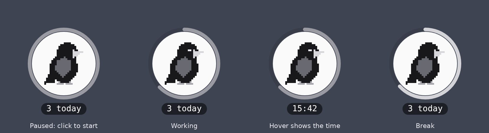

# Raven Pomodoro

A small pixel-art raven that sits on top of your other windows and runs a 25/5 Pomodoro cycle:
25 minutes of work, 5 minutes of break. It is an Electron desktop widget, built and released for
Windows, macOS and Linux. It counts your finished pomodoros for today, this week and all time.

The downloads work offline out of the box: no account, no network, and the counts are kept on your
computer. Sync is optional. If you build it with your own Supabase project, you sign in with an
email and password and the counts are kept in sync across your machines through a Supabase
(Postgres) database with Row Level Security.

- **A desktop widget.** A 192 px frameless, transparent, always-on-top window. Click the raven to
  start or pause; drag it to move it. A ring shows the time left in the phase; hovering shows the
  exact time. The tray menu has the counts, start/pause, skip and reset.
- **Offline first.** A finished pomodoro is written to a local store before anything else. In a
  sync build it is pushed to the database when there is a connection, so nothing is lost offline.
- **Optional sync through Supabase.** Email and password sign-in, an append-only `pomodoros` table,
  and Postgres Row Level Security so each account can only read and add its own rows.
- **Small on purpose.** No framework in the renderers and no server of its own.



The image is rendered from the widget's real HTML, CSS and sprites in headless Chromium with a fixed
timer state (`apps/desktop/scripts/screenshots.py`); the counts in it are sample values.

More: [architecture](docs/architecture.md), [contributing](CONTRIBUTING.md).

## Download

Get the file for your system from the
[Releases page](https://github.com/JayMirzaei/raven-pomodoro/releases):

| System | File | First launch |
|---|---|---|
| Windows | `Raven-Pomodoro-<version>-windows-setup.exe` | SmartScreen says "Windows protected your PC". Choose **More info**, then **Run anyway**. |
| macOS | `Raven-Pomodoro-<version>-mac-universal.dmg` | Drag Raven to Applications. macOS says it cannot verify the developer. Open **System Settings, Privacy & Security** and choose **Open Anyway** (on older macOS, right-click the app and choose **Open**). If it says the app "is damaged", run `xattr -dr com.apple.quarantine /Applications/Raven.app` once. |
| Linux | `Raven-Pomodoro-<version>-linux-x86_64.AppImage` | `chmod +x` the file, then run it. |

The warnings appear because the builds are not code-signed (signing needs paid Apple and Windows
certificates); they are built from this repository by the `Release` workflow on GitHub Actions. The
downloads are offline builds: there is no sign-in, and the counts stay on that computer.

Inside the app the product is called "Raven" (window titles, tray menu, the macOS app name). It
starts at login; the raven appears in the bottom-right corner, paused, and the tray icon has the
menu, including **Quit Raven**.

## Layout

```
apps/desktop/    the Electron widget (TypeScript, electron-vite, electron-builder)
  src/core/        pure logic, no Electron: timer, counts, sync loop, config, window geometry
  src/main/        the Electron main process: store, auth, sync wiring, IPC, tray, windows, autostart
  src/preload/     the window.raven bridge, the renderers' only way to the main process
  src/renderer/    widget/ and login/ pages (plain TypeScript and CSS)
  src/shared/      types, the IPC contract and phase helpers used by both sides
  src/assets/      the pixel-art sprites and icons
  scripts/         sprite, icon and screenshot generators (Python)
  test/            unit tests for src/core and src/shared
supabase/        migrations/ (schema, Row Level Security, the counts function) and test/
docs/            architecture notes and the widget image
.github/         CI and the release builds
```

## Build from source

You need Node 22.

```sh
git clone https://github.com/JayMirzaei/raven-pomodoro.git
cd raven-pomodoro
npm ci
npm run dev        # runs the app from source, offline
```

To make an installer for the system you are on:

```sh
npm run build:linux --workspace=apps/desktop   # AppImage
npm run build:mac   --workspace=apps/desktop   # universal .dmg (on macOS)
npm run build:win   --workspace=apps/desktop   # NSIS .exe (on Windows)
```

Output goes to `apps/desktop/release/`. Without Supabase settings these are offline builds, like
the downloads.

## Enable sync with your own Supabase project

Sync is chosen at build time. A build made with a Supabase URL and anon key shows a sign-in window
on first launch and syncs; a build without them is offline. You need your own Supabase project (the
free tier is enough); nothing in this repository points at one.

1. Create a project at [supabase.com](https://supabase.com).
2. Apply the migrations in `supabase/migrations/` in filename order. The simplest way is to paste
   each file into the SQL editor and run it. (The Supabase CLI's `supabase db push` should also
   work, but it was not tried with these files.)
3. Under Authentication, keep the Email provider on and turn **Confirm email** off. The app creates
   an account the first time an unknown email signs in and expects to be signed in straight away;
   it does not handle a confirmation email.
4. Copy the project URL and the anon (public) key from Project Settings, API. Never use the
   service-role key in the app.
5. Give the build the two values, either in `apps/desktop/.env`:

   ```
   SUPABASE_URL=https://<project-ref>.supabase.co
   SUPABASE_ANON_KEY=<anon key>
   ```

   (`apps/desktop/.env.example` is a template; the `.env` file is ignored by git and is not shipped)
   or as environment variables of the same names. Then run `npm run dev` or a `build:` command as
   above. The values are compiled into the app. The build stops with an error if only one is set or
   the URL is malformed.

For release builds with sync, set `SUPABASE_URL` and `SUPABASE_ANON_KEY` as repository variables
(Settings, Secrets and variables, Actions, Variables) in your fork. The anon key is public by design:
every client contains it, and Row Level Security is what protects the data.

## Development

```sh
npm run lint        # ESLint (typescript-eslint recommended rules)
npm run typecheck   # tsc for the main, preload and renderer code and the database test
npm test            # Vitest: timer, counts, sync (offline and sync builds), config, Row Level Security
npm run check       # all three
```

The Row Level Security test applies the real migrations to [PGlite](https://pglite.dev/) (Postgres
compiled to WebAssembly) with a small stand-in for Supabase's `auth` schema and roles, so it needs no
database or network.

CI (`.github/workflows/ci.yml`) runs lint, type-check, tests and the desktop build (offline, and
with placeholder sync settings) on every push and pull request.

`.github/workflows/build.yml` (the `Release` workflow) builds the Windows, macOS and Linux
installers. It needs no secrets. To publish a release, set the version in
`apps/desktop/package.json`, commit, and push a matching tag:

```sh
git tag v0.1.0 && git push origin v0.1.0
```

The workflow checks that the tag matches the version, builds on all three systems and publishes a
GitHub Release with the three files, using the `GITHUB_TOKEN` that Actions provides. Running the
workflow by hand builds the files as workflow artifacts without a release.

The sprites are drawn by `apps/desktop/scripts/gen_sprites.py` and the icons by `gen_icons.py`
(Pillow); both reproduce the committed images exactly. To redraw `docs/widget.png`:

```sh
npm run build --workspace=apps/desktop
cd apps/desktop && uv run --with playwright --with pillow python scripts/screenshots.py
```

## Design decisions in brief

- **Offline by default, sync by choice.** A build without Supabase settings has no client, no
  sign-in window and no network traffic; the same code with settings adds sign-in and sync. The
  choice is made once, at build time (`src/core/config.ts`).
- **Pure core, thin shell.** The timer, counts, sync loop and window maths in `src/core` have no
  Electron imports and take their dependencies as arguments, so they are unit-tested directly.
  `src/main` only wires them to Electron, electron-store and supabase-js.
- **The main process owns the network.** Supabase, the session and the store live in the Electron
  main process. The renderers run with context isolation and without Node, and see only a small
  `window.raven` API (get state, pause, skip, drag, sign in), whose channels and payload types are
  defined once in `src/shared/ipc.ts`.
- **Local first, then sync.** Each finished pomodoro gets a random id on the device and goes into a
  local JSON store marked unsynced. In a sync build a pass every minute, and right after each
  pomodoro, pushes unsynced rows and then asks the database for the counts. If it cannot be reached,
  the widget shows counts from the local store instead.
- **Append-only history.** Users can insert and read their own pomodoros, and nothing else: there
  is no update or delete policy. A re-sent row is ignored (`ON CONFLICT DO NOTHING`), so retries are
  safe.
- **Counts in the database, in the user's time zone.** `pomodoro_counts` takes the start of
  "today" and "this week" from the client, so the boundaries follow the user's clock, not the
  server's UTC day. It runs with the caller's rights, so Row Level Security still applies.
- **The anon key is configuration, not a secret.** Every client necessarily contains it; Row Level
  Security is what protects the data. It is still kept out of the repository and supplied at build
  time, so each build points at its own project.
- **Only a full pomodoro counts.** Skipping or resetting a work phase does not record it, and the
  timer starts paused, so launching the app never starts a session by itself.
- **Session tokens are encrypted at rest** with Electron's `safeStorage` (Keychain, DPAPI or
  libsecret) when the operating system offers it.

## Limits and what is not done

- The phase lengths are fixed at 25 and 5 minutes; there are no settings.
- A phase in progress is not saved: quitting mid-pomodoro loses it.
- There is no sign-out, password reset, account deletion or data export in the app.
- An offline build keeps its counts on one computer; nothing moves them to another. Records made
  offline are kept marked unsynced, so a sync build installed later over the same data uploads them
  after sign-in.
- In a sync build, counts shown while offline come from this machine's store only, so they can be
  lower than the synced counts.
- Weeks start on Sunday.
- In a sync build, because sign-up is open and email confirmation is off, anyone with a build can create an account,
  and an email address is not verified. Each account can only reach its own rows. Supabase's auth
  rate limits, or turning sign-ups off once your accounts exist, narrow this.
- Supabase pauses free-tier projects after a period without activity. Nothing in this repository
  keeps a project awake; use it regularly, or restore it from the Supabase dashboard.
- On Linux the autostart entry launches the AppImage with `--no-sandbox`, because an AppImage
  cannot set up Chromium's setuid sandbox. The widget only loads its own local pages.
- Electron is pinned to 33, which is past the end of its support window; moving to a current
  release is the next maintenance step.
- The builds are not code-signed or notarized. The sync app was used by hand on Ubuntu and macOS.
  The offline mode and the tag-driven Release workflow are newer: the Linux AppImage was built and
  started locally, but the Windows and macOS downloads have not been tried yet.
- Inside the app the product is called "Raven", and the app id (`com.raven.app`) and local data
  folder (`raven-desktop`) keep their original names so updates find existing data.

## Disclaimer

This is a portfolio project. It is provided "as is", without warranty of any kind, as the MIT
licence states. It can lose or miscount data, and with sync enabled it depends on a third-party
service (Supabase) that can change or stop. Whoever uses this code, or anything built from it, is responsible for that
use and its results, including the security of their own Supabase project; the author accepts no
liability for it.

## Licence

MIT. Copyright (c) 2026 Jay Mirzaei.
